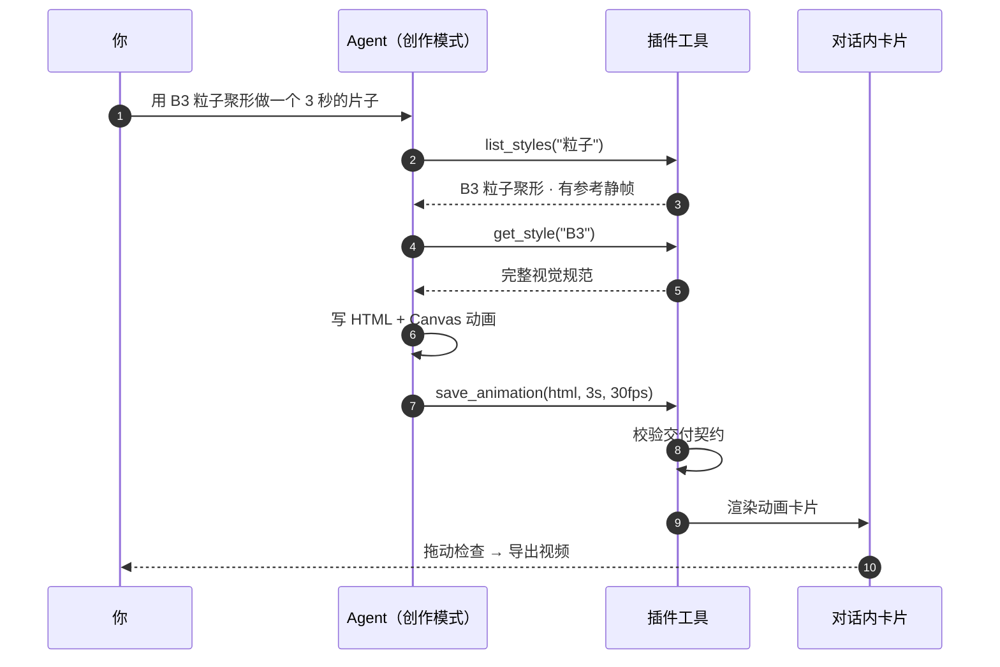
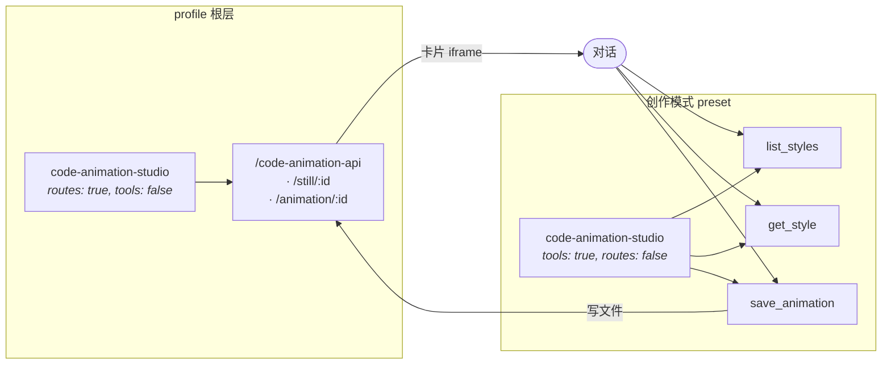

<div align="center">


<br>

# 代码动画工作台

**把 341 种代码动画风格接进对话框。说一句话，Agent 写代码，动画直接出现在对话里。**

[](https://github.com/wyf-yfw/dsh-code-animation/stargazers)
[](LICENSE)
[](#风格库)
[](#风格库)

[](https://github.com/deepseek-ai/dsh)
[](#三个工具)
[](#导出视频)
[](#参与)

</div>

---

## 它解决什么

想用代码做一段动画片，你得离开对话 → 打开一个网页工具 → 在 341 条提示词里翻找 → 复制粘贴 → 再想办法把动画录成视频。**五步里有四步和创作无关。**

这个插件把整条链路塞回对话框：



**没有第二次模型调用。** 写代码的就是已经在对话里、手上有你全部上下文的那个 Agent —— 它知道你前面聊了什么、你的品牌色是什么、你刚才否掉了哪版。

### 装上之后

模式选择器里多一项 **创作模式**，和「标准模式」「PTC 模式」并列：

<div align="center">

</div>

---

## 亮点

<table>
<tr>
<td width="50%" valign="top">

<h3>🎬 对话即工作台</h3>
<p>动画以卡片形式出现在对话流里，不是另开一个窗口。可拖动到任意时刻检查，一键导出视频。</p>

</td>
<td width="50%" valign="top">

<h3>🎨 341 种风格，带图挑</h3>
<p>每条风格都有编号、系列、适用题材。193 条带参考静帧，挑风格时能直接看效果。</p>

</td>
</tr>
<tr>
<td width="50%" valign="top">

<h3>✅ 交付契约校验</h3>
<p>生成的 HTML 必须实现 <code>window.renderAt(t)</code>、必须有 <code>&lt;canvas&gt;</code>。用了 <code>Math.random()</code> 或 <code>requestAnimationFrame</code> 会<b>在卡片上提示</b>，而不是等你导出时才发现是废片。</p>

</td>
<td width="50%" valign="top">

<h3>🧩 模式隔离</h3>
<p>工具只在<b>创作模式</b>下出现。日常写代码时不会多出三个无关工具污染上下文。</p>

</td>
</tr>
<tr>
<td width="50%" valign="top">

<h3>📦 零外部依赖</h3>
<p>不需要 ffmpeg、不需要 playwright、不需要联网。录制走浏览器原生 <code>MediaRecorder</code>。</p>

</td>
<td width="50%" valign="top">

<h3>🔒 纯本地</h3>
<p>所有生成物落在你自己的磁盘上，不经过任何第三方服务。</p>

</td>
</tr>
</table>

---

## 安装

> 需要 dsh `0.2.1` 及以上。

```bash
git clone https://github.com/wyf-yfw/dsh-code-animation.git
```

装**两个** bundle（缺一不可）：

```bash
dsh plugin install ./dsh-code-animation/plugin     # 风格库 + 工具 + 卡片
dsh plugin install ./dsh-code-animation/preset     # 声明「创作模式」
```

或者直接让 Agent 装 —— 把仓库地址丢给它，让它用 `plugin_manager` 的 `install_bundle` 分别指向 `plugin/` 和 `preset/`。

装好后：**新建会话 → 模式选择器 → 创作模式**。

---

## 用法

在创作模式下，直接用自然语言说你要什么：

| 你说 | 会发生什么 |
|---|---|
| `用 B3 粒子聚形做一个 3 秒的片子，内容是「选个风格就能出片」` | 检索 → 取规范 → 写动画 → 出卡片 |
| `帮我挑个适合讲「首屏加载从 3.2 秒压到 0.8 秒」的风格` | 返回 2–3 个候选并说明理由 |
| `换个水墨风的，竖屏 9:16` | 按 Z 系列重做，画布改 1080×1920 |
| `结尾多停 1 秒，主色换成 #E0457B` | 在原有动画上改，不用重新描述 |
| `列出中国风都有哪些` | 按系列浏览 |

### 示例提示词

```text
用 A1 字雨做一个 5 秒的动画：屏幕上不断落下「已读」「未回」「在吗」，
越堆越多，最后压成一堵墙。16:9，30fps，深色背景。

用 O96 奥本海默风格做一段 4 秒的粒子火球，主题是「我们发布了一个东西」，
要那种黎明前试验场的味道，IMAX 颗粒感。

挑一个适合讲「三个人同时改一份文档」的风格，做成 3 秒的片子，
竖屏，颜色用我们的品牌色 #4D6BFE。
```

---

## 三个工具

<table>
<tr><th width="180">工具</th><th>作用</th></tr>
<tr>
<td><code>list_styles</code></td>
<td>在 341 条风格里检索。支持关键词、系列筛选、返回条数控制。返回编号、名称、系列、适用题材、有无参考静帧、完整提示词。</td>
</tr>
<tr>
<td><code>get_style</code></td>
<td>取某一条风格的完整视觉规范与静帧地址。动手前调用。</td>
</tr>
<tr>
<td><code>save_animation</code></td>
<td>收下 Agent 写的 HTML，<b>校验交付契约</b>，存盘，返回对话内的动画卡片。参数：<code>title</code> / <code>style_id</code> / <code>duration</code> / <code>fps</code> / <code>html</code>。</td>
</tr>
</table>

### 交付契约校验

`save_animation` 会把常见错误变成卡片上的提示，而不是坏视频：

| 检查项 | 为什么 |
|---|---|
| 有 `window.renderAt(t)` | 导出要逐帧驱动；`t` 是秒，同一 `t` 必须出同一帧 |
| 有 `<canvas>` | 录制走 `canvas.captureStream()` |
| 无 `Math.random()` | 固定种子才能复现；否则每帧都在抖 |
| 无 `requestAnimationFrame` 自播 | 自播会和导出器抢时间轴 |
| 无外部脚本 / 图片 / 样式表 | 离线可复现，也避免供应链问题 |

---

## 架构



**为什么拆成两个包、同一个插件挂两次？**

preset 会被 mount 进**每个 Agent 作用域**，而 HTTP 路由是 **profile 级**的。同一个包在两处都注册路由，会直接撞车：

```
code-animation-studio (@local/dsh-code-animation):
  webserver: duplicate prefix route "/code-animation-api"
```

所以职责拆开：**路由归 profile，工具归 preset。** 两边用 `config.tools` / `config.routes` 各自只开一半。

### 目录

```
dsh-code-animation/
├── plugin/                  # @local/dsh-code-animation
│   ├── index.js             # Host：静态资源 + 生成物路由；按 config 决定装哪一半
│   ├── tools.js             # 三个工具的 schema、校验与执行
│   ├── data.js              # 风格目录的检索与投影
│   ├── client.js            # 浏览器半边：对话内动画卡片
│   ├── src/ui.js            # client.js 的可读源码（build.cjs 产出 client.js）
│   ├── styles.json          # 341 条风格（含完整提示词）
│   ├── stills/              # 193 张参考静帧，按风格编号命名
│   └── cordis.patch.yml     # 顶层行：只开路由
├── preset/                  # @local/dsh-code-animation-preset
│   └── cordis.patch.yml     # 声明「创作模式」
└── docs/
    ├── cover.html           # 封面源码（改完重新截图即可）
    └── cover.png
```

### 重新生成封面

封面是 HTML 画的，不是设计稿 —— 改文案、换配色都直接改 `docs/cover.html`，然后：

```bash
node docs/shoot-cover.cjs      # 产出 1280×640 @2x 的 docs/cover.png
```

脚本用 Chrome DevTools Protocol 驱动无头浏览器，**零 npm 依赖**，会自动找本机的 Chrome / Edge / Chromium（找不到就 `CHROME=<路径>` 指定）。

---

## 风格库

<div align="center">

| 系列 | 名称 | 数量 | | 系列 | 名称 | 数量 |
|:---:|---|:---:|---|:---:|---|:---:|
| **AG** | A–G 代码样片 | 26 | | **L** | Lemo-Opuscar | 59 |
| **M** | 动态风格 | 40 | | **V** | mg-styles-15 | 15 |
| **K** | 卡通画风 | 38 | | **X** | code-video | 31 |
| **Z** | 中国风 | 15 | | **R** | 照参考学来的 | 7 |
| **H** | 现成版式 | 12 | | **O** | 奥斯卡 98 部 | 98 |

**合计 341 条 · 其中 193 条带参考静帧**

</div>

选风格的经验（也写进了工具描述，Agent 会照做）：

- 用户给了编号就**精确匹配**，不要自作主张换
- 只描述气质时给 **2–3 个候选**并说明色彩、运动和适用内容
- **不要把多条风格的约束机械叠加** —— 主画风、运动方式、版式各选一条，各自负责一件事

---

## 导出视频

卡片上的「导出视频」按钮：

1. 读取 iframe 里的 `<canvas>`
2. `captureStream(0)` + 逐帧 `renderAt(i / fps)` + `requestFrame()`
3. `MediaRecorder` 编码成 **WebM** 下载

要 MP4 就自己转一下：

```bash
ffmpeg -i code-animation-B3.webm -c:v libx264 -pix_fmt yuv420p out.mp4
```

---

## 已知限制

- 导出是 **WebM**，不是 MP4
- 逐帧录制是**实时**的：8 秒 30fps 大约要 8 秒，期间别切走标签页（浏览器会节流后台标签）
- 341 条里 **148 条没有参考静帧**，卡片会如实标注「无静帧」
- 风格提示词里的 `{{ }}` 占位符原样保留，由 Agent 在生成时按你说的内容填
- 动画必须落在 `<canvas>` 上；纯 DOM / CSS 动画能预览但**录不了**

---

## 数据来源与许可

<table>
<tr><th>部分</th><th>许可</th></tr>
<tr><td>插件代码（<code>index.js</code> / <code>tools.js</code> / <code>data.js</code> / <code>client.js</code> / <code>src/</code>）</td><td><b>MIT</b></td></tr>
<tr><td>341 条提示词 + 193 张静帧</td><td>来自 <a href="https://github.com/XiaoyeCodes/code-animation-prompts">XiaoyeCodes/code-animation-prompts</a>，按其 <code>LICENSE.md</code> 与 <code>references/attribution.md</code> 使用</td></tr>
<tr><td>其中 L / V / X 系列</td><td>分别来自 Lemo-Opuscar、mg-styles-15、code-video，见原仓库 <code>assets/library/第三方许可/</code></td></tr>
</table>

**再分发请保留上述署名与第三方许可。** 素材版权归原作者。

---

## 参与

欢迎 PR。几个我还没做但值得做的方向：

- [ ] 服务端导出 MP4（接 ffmpeg，绕开浏览器的实时录制）
- [ ] 封面图 / 首帧自动写回会话，让 Agent 能「看到」自己做的动画
- [ ] 风格收藏与自定义风格（把 `styles.json` 开放成用户可扩展目录）
- [ ] 导出直接落到工作区文件，而不是浏览器下载

---

<div align="center">

**如果这个插件帮你省下了开网页工具、翻提示词、录屏的那半小时，给个 ⭐ 就是最好的回礼。**

<sub>Made for <a href="https://github.com/deepseek-ai/dsh">DeepSeek Harness</a> · 风格库来自 <a href="https://github.com/XiaoyeCodes/code-animation-prompts">code-animation-prompts</a></sub>

</div>
