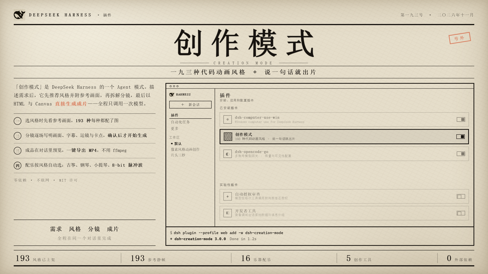
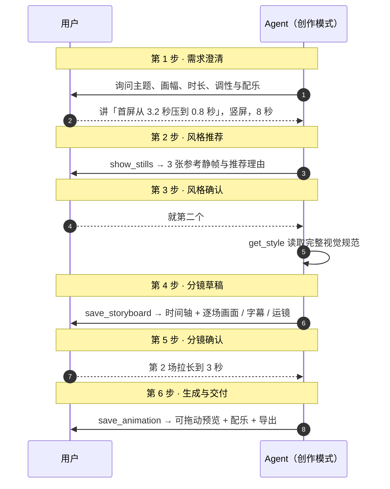
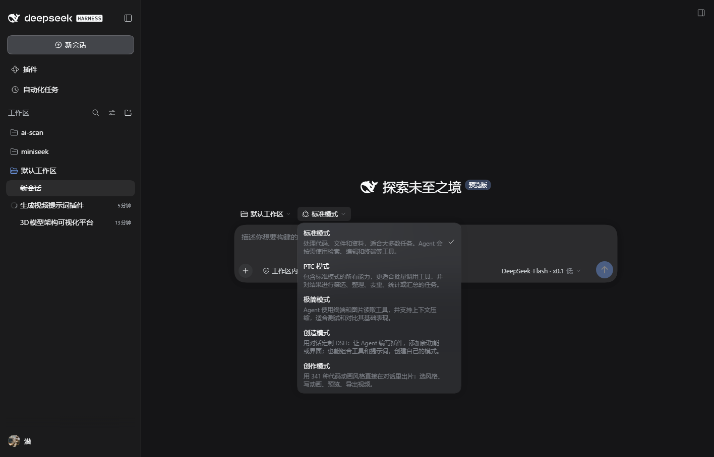

<div align="center">



# 代码动画工作台

193 种代码动画风格提示词，接入 DeepSeek Harness 对话框。

[](https://github.com/wyf-yfw/dsh-creation-mode/stargazers)
[](LICENSE)
[](https://github.com/deepseek-ai/dsh)
[](#风格库)
[](#风格库)

[](#工具参考)
[](#导出)
[](#配乐)
[](#限制)
[](#参与)

[概述](#概述) · [安装](#安装) · [使用](#使用) · [工具参考](#工具参考) · [配乐](#配乐) · [导出](#导出) · [架构](#架构) · [故障排查](#故障排查) · [限制](#限制)

</div>

---

## 概述

本项目把 [XiaoyeCodes/code-animation-prompts](https://github.com/XiaoyeCodes/code-animation-prompts)
的 341 种风格提示词封装成 DeepSeek Harness 的一个 Agent 模式。风格只有配上合格的
参考静帧才会开放，当前 **193 种已上架**，其余 148 种等补图后逐个上架（见[风格库](#风格库)）。
在该模式下，Agent 通过五个工具检索风格、提交分镜、产出动画，成品以卡片形式出现在对话中，
可直接预览与导出。

动画由对话中的 Agent 直接编写为 HTML + Canvas，不经过第二次模型调用。
导出由浏览器完成，不依赖 ffmpeg、playwright 或网络。



### 流程门禁

六步流程与两道确认门禁写在系统提示中（`plugin/flow.js`，段落序号 450，位于策略区）。
门禁的用途是控制返工成本：

| 门禁 | 原因 |
|---|---|
| 推荐风格时必须调用 `show_stills` | 文字描述不足以判断视觉风格 |
| 风格确认前不写动画代码 | 风格错误意味着整段重做 |
| 分镜确认前不写动画代码 | 分镜是结构调整成本最低的阶段 |

`save_animation` 未携带 `storyboard_id` 时，预览卡片会标注「未经用户拍板」。
用户若在首条消息中同时给出风格编号与内容，可跳过前三步，分镜确认不可跳过。

### 界面

模式选择器新增「创作模式」：

<div align="center">

</div>

参考静帧与分镜草稿渲染在**产生它们的那条工具行里**，随结果落地即可见；动画预览渲染于
`conversation.chat.turnTail`（回合末尾）。因此用户在回合进行中被要求选风格或拍板分镜时，
就已经能看到画面，不必等回合结束：

```
✓ 已处理 6 步                                    可折叠的工具调用日志
show_stills                                       ← 静帧就在这里，展开前也可见
┌─────────────────────────────────────────┐
│ ● 风格候选            3 条参考静帧        │
│ [静帧] [静帧] [静帧]                      │
└─────────────────────────────────────────┘
save_storyboard
┌─────────────────────────────────────────┐
│ ● 分镜 · 首屏加速        3 场 · 8s · 9:16 │
│ ▓▓▓▓░░░░░░░░░░░░░░░░░░░░░░░░░░           │
│ 1  0.00–2.40s  粒子崩塌成数字…            │
└─────────────────────────────────────────┘
你的片子做好了，B3 粒子聚形，8 秒。
┌─────────────────────────────────────────┐
│ ● 首屏加速         B3 粒子聚形  8s 30fps  │     回合末尾卡片
│ [ 动画预览 ]              [ 导出视频 ]    │
│ 配乐 [脉冲 ▾]  格式 [MP4 ▾]      [试听]   │
└─────────────────────────────────────────┘
```

---

## 安装

要求 dsh `0.2.1` 及以上。

```bash
git clone https://github.com/wyf-yfw/dsh-creation-mode.git
```

从 npm 安装（已发布后）：

```bash
dsh plugin --profile web add dsh-creation-mode
```

或从本地克隆安装：

```bash
dsh plugin --profile web add ./dsh-creation-mode/plugin
```

一个 bundle 插两行：profile 根行提供风格目录与动画的 HTTP 路由，预设行声明「创作模式」并挂载创作工具。

安装后新建会话，在模式选择器中选择「创作模式」。

### 在插件页搜索安装

`dsh plugin add` 与插件页的「搜索」是两个独立入口：前者按包名从 npm 源安装，后者读的是
**插件市场索引**（market index）。仓库根目录的 [`market.json`](market.json) 就是一份
format 1 索引，把它加到设置里即可在插件页看到「创作模式」：

```json
{
  "indexes": ["https://raw.githubusercontent.com/wyf-yfw/dsh-creation-mode/main/market.json"]
}
```

索引通过 `dsh-plugin-market-index` 的 `parseMarketIndex` 校验，`source.type: "npm"`
表示该版本从 npm 安装；发布新版本后需要同步更新 `versions` 与 `publishTimestamp`。

---

## 使用

在创作模式下用自然语言描述需求即可。

| 输入 | 行为 |
|---|---|
| `想做个视频，讲我们这次把首屏从 3.2 秒压到 0.8 秒` | 提出澄清问题：受众、画幅、时长、调性 |
| `帮我挑个适合讲「三个人同时改一份文档」的风格` | 返回 2–3 个候选并附参考静帧 |
| `就第二个` | 读取该风格规范，提交分镜草稿待审 |
| `第 2 场拉长到 3 秒，结尾加一句「这次真的快了」` | 更新分镜并重新提交 |
| `可以，开始做` | 编写动画，输出预览卡片 |
| `用 B3 做一个 3 秒的粒子聚形，内容是 XXX` | 跳过前三步，仍先提交分镜 |
| `换个水墨风的，竖屏 9:16` | 按 Z 系列重做，画布改为 1080×1920 |

示例：

```text
想做一个 8 秒的竖屏短片，讲「首屏加载从 3.2 秒压到 0.8 秒」，
发在朋友圈，要爽快、有冲击力，主色 #4D6BFE。

用 A1 字雨做一个 5 秒的动画：屏幕上不断落下「已读」「未回」「在吗」，
越堆越多，最后压成一堵墙。16:9，30fps，深色背景。

用 O96 奥本海默风格做一段 4 秒的粒子火球，主题是「我们发布了一个东西」，
要黎明前试验场的质感，IMAX 颗粒。
```

---

## 工具参考

| 工具 | 阶段 | 作用 |
|---|---|---|
| `list_styles` | 2 | 检索已上架风格（当前 193 条），返回编号、名称、系列、适用题材、有无静帧、完整提示词 |
| `show_stills` | 2 | 将参考静帧作为图片写入对话，供风格判断 |
| `get_style` | 3 之后 | 读取单条风格的完整视觉规范 |
| `save_storyboard` | 4 | 提交分镜草稿并校验结构，渲染为时间轴与逐场清单 |
| `save_animation` | 6 | 校验 HTML 交付契约，落盘并挂载预览卡片 |

### 参数

**`list_styles`**

| 参数 | 类型 | 说明 |
|---|---|---|
| `query` | string | 关键词、风格名或编号，如 `水墨` / `B3` |
| `series` | string | 限定系列：`AG` `M` `K` `Z` `H` `L` `V` `X` `R` `O` |
| `limit` | integer | 返回条数，默认 12，上限 50 |

**`show_stills`**

| 参数 | 类型 | 说明 |
|---|---|---|
| `ids` | string[] | 风格编号，单次上限 4 条 |
| `note` | string | 推荐理由，显示在图片上方 |

**`save_storyboard`**

| 参数 | 类型 | 说明 |
|---|---|---|
| `title` | string | 片名 |
| `style_id` | string | 已确认的风格编号 |
| `duration` | number | 总时长（秒） |
| `fps` | integer | 帧率，默认 30 |
| `aspect` | enum | `16:9` / `9:16` / `1:1` |
| `music` | enum | 配乐预设，留空按风格自动选择 |
| `shots[]` | object[] | 镜头列表，字段：`start` `end` `scene` `text` `camera` |

**`save_animation`**

| 参数 | 类型 | 说明 |
|---|---|---|
| `title` | string | 片名 |
| `html` | string | 完整的动画 HTML 正文，上限 2 MB |
| `style_id` | string | 采用的风格编号 |
| `storyboard_id` | string | 已确认的分镜 id |
| `duration` / `fps` | number | 覆盖分镜中的取值 |
| `music` | enum | 覆盖分镜中的配乐 |

### 分镜校验

`save_storyboard` 检查以下结构问题，结果附在草稿卡片上：

| 检查项 | 示例输出 |
|---|---|
| 时间空档 | 第 2 场与上一场之间有 3s 空档 |
| 时间重叠 | 第 3 场与上一场时间重叠 |
| 起止倒置 | 第 2 场的结束时间不大于开始时间 |
| 超出总时长 | 第 4 场超出总时长 8s |
| 缺画面描述 | 第 2 场没有写画面内容 |
| 字幕过长 | 第 1 场字幕 19 字，2s 的镜头最多约 11 字，删到只剩一件事 |
| 字幕有套话 | 第 1 场字幕有套话「赋能、让我们一起」，换成具体的东西 |
| 场次过少 | 只有 1 场：分镜至少拆成 3 场才有节奏 |
| 时长不齐 | 各场时长合计 6s，与总时长 8s 不一致 |

字幕按每秒 5.5 字估算阅读上限——一条字幕只有停留的那一两秒可读。套话表只报警告，
引用或刻意使用时由 Agent 自行判断。文案本身的写法见 `flow.js` 的「文案标准」小节。

### 交付契约校验

`save_animation` 校验 HTML 是否满足预览与导出所需的接口：

| 检查项 | 原因 |
|---|---|
| 存在 `window.renderAt(t)` | 导出逐帧驱动，`t` 为秒，同一 `t` 须渲染同一帧 |
| 存在 `<canvas>` | 录制基于 `canvas.captureStream()` |
| 无 `Math.random()` | 需固定种子以保证可复现 |
| 无 `requestAnimationFrame` 自播 | 自播会与导出器争夺时间轴 |
| 无外部脚本、图片、样式表 | 离线可复现，并规避供应链风险 |
| 关联了分镜 | 否则卡片标注「未经用户拍板」 |

---

## 风格库

<div align="center">

| 系列 | 名称 | 已上架/总数 | | 系列 | 名称 | 已上架/总数 |
|:---:|---|:---:|---|:---:|---|:---:|
| **AG** | A–G 代码样片 | 26 / 26 | | **L** | Lemo-Opuscar | 59 / 59 |
| **O** | 奥斯卡 98 部 | 98 / 98 | | **R** | 照参考学来的 | 7 / 7 |
| **M** | 动态风格 | 1 / 40 | | **Z** | 中国风 | 1 / 15 |
| **H** | 现成版式 | 1 / 12 | | **K** | 卡通画风 | 0 / 38 |
| **V** | mg-styles-15 | 0 / 15 | | **X** | code-video | 0 / 31 |

合计 **193 条已上架**。库中 341 条，其余 148 条尚未开放：这些风格缺合格参考静帧，
在补图之前既不出现在检索结果里，也不能被选中（详见下节）。

</div>

选风格时，主画风、运动方式与版式各取一条，不叠加多条风格的完整约束。

### 上架白名单

风格是否开放由 `plugin/stills/approved.json` 决定，而不是文件是否存在：

```json
{
  "note": "上架白名单：只有列在这里的风格才会出现在检索结果里。",
  "approved": ["A1", "A2", "B3", "..."]
}
```

只有列进 `approved` 的风格才会进入目录。约束覆盖全部出口，因此不存在绕过路径：

| 出口 | 未上架时的行为 |
|---|---|
| `list_styles` | 不返回，工具描述里的数量也按当前上架数生成 |
| `get_style` | 视为不存在的编号，改为提示相近编号 |
| `show_stills` | 报「参考图还没上架」，与「编号写错」区分 |
| `/code-animation-api/still/<id>` | 返回 404，手输 URL 也拿不到 |

**补图流程**：把合格的静帧放到 `plugin/stills/<编号>.jpg`，再把编号追加进
`approved` 数组即可上架；文件不必删除或改名。`stills/index.json` 是上游原始清单，
仅供对照。

---

## 配乐

音轨由 Web Audio 程序化合成：不引入音频素材，不访问网络，也不调用音频生成模型。
合成在 `OfflineAudioContext` 中离线完成，长度与影片严格一致，并与画面共用同一时钟。

### 配乐代码是模型现写的

和动画画面一样，**配乐也是 Agent 为这一条片子当场写的代码**，不是从音色库里挑的：

```js
// save_animation 的 score_js 形参：ctx, dest, duration, cuts, cues, rand, hz
function pluck(freq, at, dur, vol) {      // Karplus-Strong 拨弦，像古筝
  const n = Math.floor(ctx.sampleRate / freq);
  const buf = ctx.createBuffer(1, n * 2, ctx.sampleRate);
  const d = buf.getChannelData(0);
  for (let i = 0; i < d.length; i++) d[i] = rand() * 2 - 1;
  ...
}

for (let t = 0; t < duration; t += 0.5) pluck(hz(57 + pentatonic()), t, 1.2, 0.08);  // 铺底：轻
for (const t of cuts) drum(t, 0.7);                                                  // 卡点：重
```

| 环节 | 谁做的 |
|---|---|
| 画面 HTML + Canvas | Agent 现写 |
| 配乐合成代码 | Agent 现写 |
| 编译并渲染成音频 | 浏览器执行 |

音色完全由 Agent 决定：要古筝就写拨弦算法，要竹笛就写噪声过共振峰，要鼓就写正弦下扫加噪声瞬态。
没有任何音色预设表，也没有关键词匹配。

**内置合成引擎只是兜底**——当 `score_js` 留空、编译失败，或渲染出的音轨是静音时启用。
它的音色是按通用场景准备的，配不上具体片子。

实测对比（同一组切点）：

| | 切点对比 | 峰值 |
|---|---|---|
| 模型自写配乐 | **36×**（0.192 / 0.005） | 0.65 |
| 内置引擎兜底 | 1.6× | 0.88 |

差距来自稀疏度：模型写的是有目的、留白的配乐，内置引擎铺了一整片「床」，重击容易被淹。

### 少样本音色库

提示词里附了 **28 条已逐个试听校准**的音色配方，覆盖原声与电子两大类：

| 类别 | 条目 |
|---|---|
| 打击乐 | 底鼓、军鼓、闭合踩镲、开镲、通鼓、吊镲、808 底鼓、四踩律动 |
| 拨弦与弦乐 | 古筝拨弦、清音吉他、失真主音、弦乐铺底、低频贝斯 |
| 管乐与音块 | 竹笛、钟铃、马林巴 |
| 电子 | 酸性贝斯 303、超级锯齿、合成拨弦、琶音、FM 贝斯、门限铺底、芯片方波、抖动贝斯、侧链泵动 |
| 转场 | 上行扫频、下坠噪声、落重音 |

每条都写明「听感」和一个具体做法，例如：

| 音色 | 听感 | 做法 |
|---|---|---|
| 底鼓 kick | 低频冲击，几乎无音高感 | 正弦 160→44Hz 在 70ms 内扫完，衰减 0.16s，叠 6ms 噪声瞬态 |
| 酸性贝斯 303 | 锯齿过强共振，每个音「呜」一下 | 锯齿过 Q=11 状态变量滤波，截止 240→2840Hz 指数衰 0.075s |
| 古筝拨弦 | 明亮拨弦，金属余韵 | Karplus-Strong，循环反馈 0.998 |

另外附了三个完整代码示例：Karplus-Strong 拨弦、状态变量滤波器扫频、超级锯齿叠加。

校准用到的试听素材在 [`docs/sound-samples/`](docs/sound-samples/index.html)，可以直接打开逐条试听。

### 内置引擎（兜底）

`music` 参数是自由文本，没有枚举限制。留空 `score_js` 时，引擎从这段描述里解析调式、
和弦进行、音色与鼓组，合成一条音轨。同一段描述永远生成同一条音轨（同种子逐样本一致）。

| 描述线索 | 解析结果 |
|---|---|
| 国风 / 水墨 / 禅 / ink | 五声音阶、三角波拨弦、稀疏鼓组、大混响 |
| 史诗 / 宏大 / 大片 / epic | 自然小调、锯齿波、反拍军鼓、强重击 |
| 赛博 / 科技 / 故障 / synth | 小调、锯齿波、四踩底鼓、明亮滤波 |
| 轻快 / 卡通 / bright | 大调、正弦波、反拍、轻力度 |
| 快 / 燃 / 紧张 / pulse | 多利亚调式、四踩、短促拨弦 |
| 氛围 / 空灵 / ambient | 小调五声、长音铺底、极简节奏 |

### 卡点

卡点要成立，需要两件事同时做到：

**① 切点落在小节线上**——这是速度与相位问题。引擎遍历 60–190 BPM，为每个候选速度计算
所有切点到最近**小节线**（而非最近拍）的偏差，取偏差最小者；偏差接近时优先保留该情绪的目标速度。
这与 `web-audio-beat-detector` 联合估计「速度 + 首拍相位」是同一个问题，只是反过来了：
这里切点已知，音乐是被写上去的。

| 切点 | 拟合结果 | 说明 |
|---|---|---|
| 1.5 / 3.0 / 4.5s | **160 BPM，每场正好一小节，fit = 1.0** | 完全对齐 |
| 0.9 / 2.7 / 4.1s | 176 BPM，fit = 0.51 | 间隔不等，只能折中 |
| 无切点 | 回退到情绪目标速度 | fit = 0 |

**② 小节里要有真正的律动**——只有长音加零星爆炸，耳朵不会把爆炸听成重音，因为没有脉冲可打破。
所以每个小节都有底鼓、军鼓、踩镲、贝斯与和弦，重音落在听者预期的强拍上。

**③ 重击要能穿透**——所有旋律与鼓组先汇入一条 bed 总线，卡点前 100ms 该总线侧链下沉，
重击直达主输出。这样重击落在空隙里，而不是叠在同样响的铺底之上。

实测穿透比（切点处 RMS ÷ 切点前 160ms RMS）：

| 切点 | 前 | 处 | 穿透比 |
|---|---|---|---|
| 1.5s | 0.119 | 0.190 | **1.60×** |
| 3.0s | 0.120 | 0.175 | **1.46×** |
| 4.5s | 0.117 | 0.195 | **1.67×** |

16 分音符网格上的能量标准差 / 均值 = **0.42**（铺底若有律动，这个数不会接近 0）。

### 镜头内部的卡点

卡点不只发生在分镜之间。分镜的每个镜头可带 `cues`，标记镜头内部的关键视觉动作：

```json
{
  "start": 0, "end": 2, "scene": "粒子聚成标题",
  "cues": [
    { "time": 0.8, "type": "impact", "label": "标题砸下" },
    { "time": 1.6, "type": "rise",   "label": "能量聚拢" }
  ]
}
```

每条 cue 都会得到**样本级精确**的重音（不是四舍五入到拍上）：
前接一段上行扫频、侧链让位、然后落一记「下潜低频 + 噪声撞击 + 本位和弦重音」。
`save_animation` 也可以直接传 `cues`，与分镜里的合并生效。

### 自定义音频

卡片上可选择「更换音频」载入本地文件。文件仅在浏览器内混入，不上传，也不写回工作区；
短文件自动循环补满，末尾自动淡出。

### 可复现性

同一组 `music + duration + cuts + cues + seed` 渲染出的音轨逐样本一致（同种子差异量级 1e-7，
音频渲染器的浮点噪声）。峰值留有余量，不削波（实测 0.88，低于满刻度）。

---

## 导出

| 格式 | 编码 | 说明 |
|---|---|---|
| **MP4**（默认） | H.264 + AAC | 可直接发送至社交平台，或导入剪映、Premiere、Final Cut |
| **WebM** | VP9 + Opus | 浏览器不支持 MP4 时的回退 |

格式下拉只列出当前浏览器实际支持的容器。Chromium 内核（Chrome / Edge 111+）支持直接录制 MP4，
产出为标准 MP4（`ftyp isom` + `avc1`），非改名文件。

导出流程：

1. 读取预览 iframe 中的 `<canvas>`
2. 按分镜切点渲染配乐，混为单条音轨
3. `captureStream(0)` + 逐帧 `renderAt(i / fps)` + `requestFrame()`
4. `MediaRecorder` 编码
5. 由 Host 写入**会话工作目录下的 `code-animation/`**，卡片显示完整路径

### 文件位置与自定义保存目录

成片默认写入会话工作目录：

```
<会话工作目录>/code-animation/<片名>.mp4
```

卡片在导出前就显示目标目录，并提供「📂 选择文件夹…」按钮：
- 支持唤起本地文件夹选择窗口，自由指定任意保存目录（如桌面或其他工程文件夹）
- 导出后直接保存到选定目录，并替换为完整文件路径
- 若 Host 不可达，会自动退回浏览器下载，并在卡片上说明。

### 导出状态

导出后卡片报告音轨状态：

| 状态 | 含义 |
|---|---|
| `含配乐` | 音频已进入录制 |
| `无声` | 选择了「无配乐」 |
| `⚠ 配乐未进入录制` | 浏览器未启动音频（无音频设备或页面被静音），此时不会把无声文件当作配乐成片交付 |

### 为什么需要手动点击

导出不是自动的，原因有两条：

- 浏览器要求**用户手势**才能启动 `AudioContext`，自动导出会得到无声文件
- 录制是**实时**的，8 秒片子需要 8 秒；对长片自动执行会长时间占用页面

重新编码：

```bash
ffmpeg -i in.mp4 -c:v libx264 -crf 20 -c:a aac -b:a 192k out.mp4
```

> 本插件本身不需要 ffmpeg。上面这条命令只用于你自己重新编码。

---

## 架构


同一个插件挂载两次，职责分离。preset 会挂载进每个 Agent 作用域，而 HTTP 路由是 profile 级的，
两处都注册路由会冲突：

```
code-animation-studio (dsh-creation-mode):
  webserver: duplicate prefix route "/code-animation-api"
```

因此路由归 profile 层，工具归 preset 层，各自由 `config.routes` 与 `config.tools` 控制。

### 卡片渲染位置

```
conversation.chat.node（工具组）
  └─ tool.call.toolview     工具行；show_stills / save_storyboard 的卡片挂在这里
                            （回合进行中即渲染，随结果落地可见）

conversation.chat.turnTail（回合末尾，始终展开）
  └─ code-animation-studio  动画预览（回合结束后才发布）
```

卡片位置是实测出来的：`turnTail` 只在 `turn/end` 发布，而用户是在回合**进行中**
被要求选风格、拍板分镜的，那时它还没渲染，所以静帧与分镜改挂在产生它们的工具行上。

数据来自 `uiConversation.events.register()` 注册的回合级投影：将每个回合中
`show_stills`、`save_storyboard`、`save_animation` 的落盘参数与结果文本折叠为一份回合数据。
工具行卡片则直接读工具结果的 `meta`（Host 回传的结构化草稿），不再正则解析文本。
数据源为会话日志而非插件内存，因此刷新页面与重放历史会话均可还原。

### 目录

```
dsh-creation-mode/
├── plugin/                  # npm 包 dsh-creation-mode（bundle 根）
│   ├── index.js             # Host：路由与挂载；按 config 决定装载哪一半
│   ├── flow.js              # 六步流程与门禁的系统提示段落
│   ├── tools.js             # 五个工具的 schema、校验与执行
│   ├── data.js              # 风格目录的检索、投影与风格到配乐的映射
│   ├── client.js            # 浏览器端：回合末尾卡片（含配乐引擎）
│   ├── src/ui.js            # client.js 的可读源码
│   ├── src/music.js         # 程序化配乐：八个预设、卡点拟合、离线渲染
│   ├── styles.json          # 341 条风格提示词（其中 193 条已上架）
│   ├── stills/              # 参考静帧；approved.json 是上架白名单，index.json 是上游清单
│   └── cordis.patch.yml     # 两行：根行开启路由；预设行声明「创作模式」
└── docs/
    ├── cover.html           # 封面源码
    ├── cover.png
    ├── mode-picker.png
    └── shoot-cover.cjs      # 重新生成封面
```

### 重新生成封面

封面由 HTML 渲染，修改 `docs/cover.html` 后执行：

```bash
node docs/shoot-cover.cjs      # 输出 1280×640 @2x 的 docs/cover.png
```

脚本通过 Chrome DevTools Protocol 驱动无头浏览器，无 npm 依赖，
自动查找本机 Chrome / Edge / Chromium，或用 `CHROME=<路径>` 指定。

---

## 限制

- **升级插件后需重启 dsh**，见 [故障排查](#故障排查)
- 导出为实时录制：8 秒 30fps 约需 8 秒，期间切换标签页会被浏览器节流
- 导出需手动点击，不自动执行：`AudioContext` 需要用户手势，且录制耗时与片长成正比
- MP4 录制需要 Chromium 111+；Firefox 将回退至 WebM
- 配乐为程序化合成，非真实乐器录音
- 自定义音频仅在浏览器内混入，不上传，不写回工作区
- 风格提示词中的 `{{ }}` 占位符原样保留，由 Agent 在生成时填入
- 动画必须渲染到 `<canvas>`；纯 DOM / CSS 动画可预览但无法录制

---

## 故障排查

### 规则：更新插件后必须重启 dsh

Agent 创建模式挂载的是 `dsh-creation-mode` 模块的一个实例，该模块在 **dsh 进程启动时导入一次**
并留在 ESM 缓存中。在 Web 界面里禁用再启用插件行不会重新导入模块，因此：

- 修改或升级插件后，**必须重启 `dsh web`**
- 未重启时，创作模式运行的是旧版本：可能缺少工具、卡片不渲染、或界面提示与实际不符
- 已存在的会话保留创建时的插件版本；验证新版行为请新建会话

### 检查当前加载的版本

```bash
curl -s http://127.0.0.1:3080/code-animation-api/health
```

```json
{
  "ok": true,
  "rev": 7,
  "tools": ["list_styles", "show_stills", "get_style", "save_storyboard", "save_animation"],
  "styles": 193,
  "stills": 193
}
```

| 字段 | 判读 |
|---|---|
| 缺少 `rev` / `tools` | 加载的是 rev 3 之前的版本，需要重启 |
| `rev` 低于仓库中的 `BUILD_REV` | 加载的是旧版本，需要重启 |
| `tools` 少于五项 | 同上 |
| `styles` / `stills` 与上架数不符 | 白名单未生效，检查 `stills/approved.json` |

`BUILD_REV` 定义在 `plugin/data.js`，工具名或结果结构变化时应递增。

### 卡片没有出现

依次检查：

1. `health` 的 `rev` 是否与仓库一致；不一致则重启
2. 该会话是否在**创作模式**下创建；其他模式不挂载这些工具
3. 会话中是否调用过 `save_animation`；只有调用过才有卡片
4. 浏览器控制台是否有 `slot entry crashed` 报错

### Agent 自己写脚本或去装 ffmpeg

这是工具不可用的典型表现：没有 `save_storyboard` 时，Agent 会尝试用命令行自行录制。
按上一节确认 `tools` 齐全后重启即可。`plugin/flow.js` 中也已明确禁止自建录制脚本、
禁止查找或安装 ffmpeg、禁止使用 playwright。

---

## 素材来源与许可

| 部分 | 许可 |
|---|---|
| 插件代码（`index.js`、`tools.js`、`data.js`、`flow.js`、`client.js`、`src/`） | MIT |
| 341 条风格提示词 | 基础库来自 [XiaoyeCodes/code-animation-prompts](https://github.com/XiaoyeCodes/code-animation-prompts)，遵循其 `LICENSE.md` 与 `references/attribution.md` |
| 参考静帧 | 上游原始静帧（193 张，即当前上架部分）遵循同一许可 |
| 其中 L / V / X 系列 | 分别来自 Lemo-Opuscar、mg-styles-15、code-video，第三方许可见原仓库 `assets/library/第三方许可/` |

再分发时请保留上述署名与第三方许可。素材版权归原作者。

---

## 参与

Issue 与 PR 均可。以下方向尚未实现：

- [ ] 服务端导出 MP4，接入 ffmpeg 以避开浏览器的实时录制约束
- [ ] 将封面图或首帧写回会话，使 Agent 能检视自身产出
- [ ] 风格收藏与自定义风格目录
- [ ] 导出直接写入工作区文件，而非浏览器下载

---

<div align="center">

<sub>为 <a href="https://github.com/deepseek-ai/dsh">DeepSeek Harness</a> 构建 ·
风格库来自 <a href="https://github.com/XiaoyeCodes/code-animation-prompts">code-animation-prompts</a></sub>

</div>
