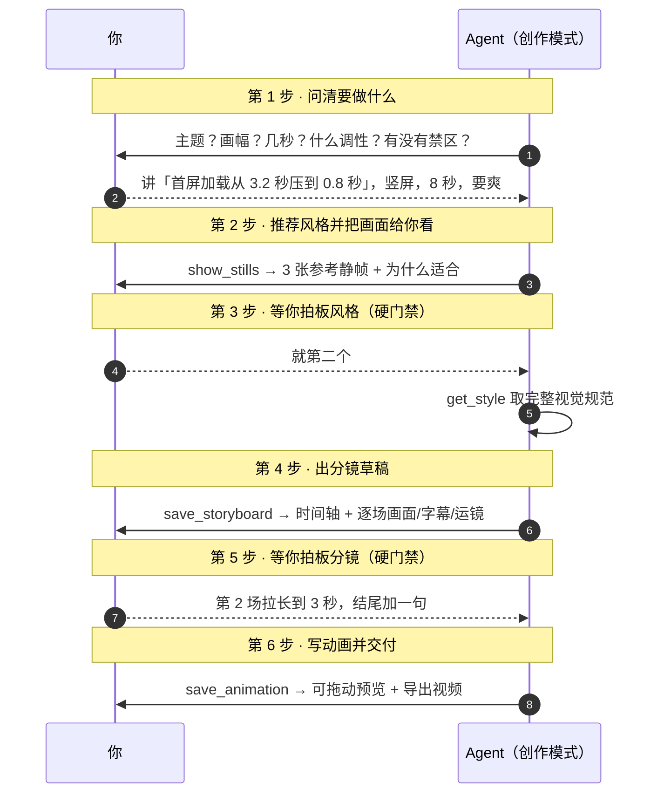
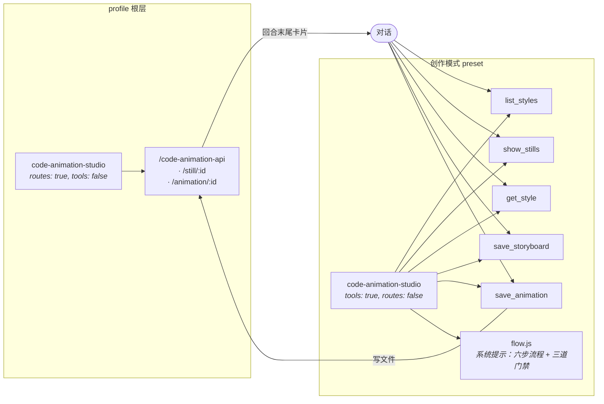

<div align="center">


<br>

# 代码动画工作台

**把 341 种代码动画风格接进对话框。说一句话，Agent 写代码，动画直接出现在对话里。**

[](https://github.com/wyf-yfw/dsh-code-animation/stargazers)
[](LICENSE)
[](https://github.com/deepseek-ai/dsh)
[](#风格库)
[](#风格库)

[](#五个工具)
[](#导出视频)
[](#配乐按风格挑按切点卡拍)
[](#亮点)
[](#参与)

</div>

---

## 它解决什么

想用代码做一段动画片，你得离开对话 → 打开一个网页工具 → 在 341 条提示词里翻找 → 复制粘贴 → 再想办法把动画录成视频。**五步里有四步和创作无关。**

这个插件把整条链路塞回对话框，而且**不让你一上来就闷头写代码**：



**没有第二次模型调用。** 写代码的就是已经在对话里、手上有你全部上下文的那个 Agent —— 它知道你前面聊了什么、你的品牌色是什么、你刚才否掉了哪版。

### 配乐：按风格挑，按切点卡拍

导出的片子**默认带配乐**。没有音频素材、不联网、不碰版权——整条音轨是用 Web Audio **程序化合成**的。

**① 配乐跟着风格走**

八个预设，风格决定默认值，你不满意可以随时换：

| 预设 | 用在什么风格上 |
|---|---|
| `guofeng` 国风 | Z 中国风全部；水墨 / 敦煌 / 皮影 / 剪纸（五声音阶 + 拨弦） |
| `epic` 史诗 | O 奥斯卡（3D 优先）、L Lemo-Opuscar |
| `synth` 合成波 | 赛博 / 霓虹 / CRT / 故障 / R 系列 |
| `ambient` 氛围 | 黑白与默片题材、O 系列的 2D·B&W |
| `bright` 轻快 | K 卡通画风、M 动态风格 |
| `pulse` 脉冲 | AG 代码样片、H 版式、V、X |
| `lofi` | 想要颗粒感时手动选 |
| `none` | 静音 |

**② 配乐跟着切点卡拍**

分镜里每个镜头的起止时间就是配乐的重音落点。导出时不是套一个固定 BPM，而是**反推**：遍历 60–180 BPM，选出让所有切点最贴近节拍（且优先落在小节线上）的那个速度，然后在每个切点上叠一记 crash + 低音，前面加一小段上行音。

```
分镜：  0 ──── 1.5 ──── 3.0 ──── 4.5 ──── 6.0s
配乐：  ↓        ↓        ↓        ↓
       起拍    重音     重音     重音    收尾
               速度拟合结果：160 BPM（每场 4 拍，正好落在小节线上）
```

实测：切点处的能量是周围的约 2 倍（0.21 vs 0.10–0.15 RMS），听得出来。

**③ 也能用你自己的音频**

卡片上选「自定义音频…」，导出时会把你的文件混进去，短文件自动循环补满整片、末尾自动淡出。

**④ 可复现**

同一个种子渲染出的音轨逐样本一致。换种子才会得到不同的曲子。

### 三道门禁

流程写在系统提示里，不是靠 Agent 自觉：

| 门禁 | 为什么 |
|---|---|
| **先给图，再让你选** | 只用文字描述风格，你没法判断合不合口味。推荐完风格必须先 `show_stills` 把参考静帧贴出来。 |
| **你拍板风格之前不写代码** | 选错风格 = 整段白写。 |
| **你拍板分镜之前不写代码** | 分镜是最后一处能低成本改结构的地方；写完动画再改就是重做。 |

`save_animation` 没带 `storyboard_id` 时，卡片上会直接标注「这版动画未经用户拍板」——跳过流程是有痕迹的。

**唯一可以跳步的情况**：你在一句话里把风格和内容都给全了（"用 B3 做一个 3 秒的粒子聚形"）。这时跳过前三步，但分镜确认仍然不能跳过。

### 装上之后

模式选择器里多一项 **创作模式**，和「标准模式」「PTC 模式」并列：

<div align="center">

</div>

### 卡片在哪儿

参考静帧、分镜草稿、动画预览都渲染在**回合末尾、可折叠工具组之外**：

```
✓ 已处理 6 步                                    ← 工具组，折叠着也不影响你
                                                   （点开才看得到调用细节）
你的片子做好了，B3 粒子聚形，8 秒。

┌─────────────────────────────────────────┐
│ ● 风格候选            3 条参考静帧        │      ← 回合级卡片
│ [静帧] [静帧] [静帧]                      │         一直在，不用展开任何东西
├─────────────────────────────────────────┤
│ ● 分镜 · 首屏加速        3 场 · 8s · 9:16 │
│ ▓▓▓▓░░░░░░░░░░░░░░░░░░░░░░░░░░           │
│ 1  0.00–2.40s  粒子崩塌成数字…            │
├─────────────────────────────────────────┤
│ ● 首屏加速         B3 粒子聚形  8s 30fps  │
│ [ 动画预览 ]              [ 导出视频 ]    │
│ ─────────●──────────────────────          │
└─────────────────────────────────────────┘
```

工具组里放的是调用日志；真正要看的东西在下面，**永远不会折叠起来**。

---

## 亮点

<table>
<tr>
<td width="50%" valign="top">

<h3>🎬 对话即工作台</h3>
<p>动画以卡片形式出现在对话流里，不是另开一个窗口。可拖动到任意时刻检查，一键导出视频。</p>

</td>
<td width="50%" valign="top">

<h3>🎨 341 种风格，带图挑</h3>
<p>每条风格都有编号、系列、适用题材。193 条带参考静帧，挑风格时能直接看效果。</p>

</td>
</tr>
<tr>
<td width="50%" valign="top">

<h3>✅ 交付契约校验</h3>
<p>生成的 HTML 必须实现 <code>window.renderAt(t)</code>、必须有 <code>&lt;canvas&gt;</code>。用了 <code>Math.random()</code> 或 <code>requestAnimationFrame</code> 会<b>在卡片上提示</b>，而不是等你导出时才发现是废片。</p>

</td>
<td width="50%" valign="top">

<h3>🧩 模式隔离</h3>
<p>工具只在<b>创作模式</b>下出现。日常写代码时不会多出三个无关工具污染上下文。</p>

</td>
</tr>
<tr>
<td width="50%" valign="top">

<h3>📦 零外部依赖</h3>
<p>不需要 ffmpeg、不需要 playwright、不需要联网、不需要音频素材。录制走浏览器原生 <code>MediaRecorder</code>，配乐用 Web Audio 现场合成。</p>

</td>
<td width="50%" valign="top">

<h3>🔒 纯本地</h3>
<p>所有生成物落在你自己的磁盘上，不经过任何第三方服务。</p>

</td>
</tr>
</table>

---

## 安装

> 需要 dsh `0.2.1` 及以上。

```bash
git clone https://github.com/wyf-yfw/dsh-code-animation.git
```

装**两个** bundle（缺一不可）：

```bash
dsh plugin install ./dsh-code-animation/plugin     # 风格库 + 工具 + 卡片
dsh plugin install ./dsh-code-animation/preset     # 声明「创作模式」
```

或者直接让 Agent 装 —— 把仓库地址丢给它，让它用 `plugin_manager` 的 `install_bundle` 分别指向 `plugin/` 和 `preset/`。

装好后：**新建会话 → 模式选择器 → 创作模式**。

---

## 用法

在创作模式下，直接用自然语言说你要什么：

| 你说 | 会发生什么 |
|---|---|
| `想做个视频，讲我们这次把首屏从 3.2 秒压到 0.8 秒` | **先反问你**：给谁看？几秒？什么调性？ |
| `帮我挑个适合讲「三个人同时改一份文档」的风格` | 返回 2–3 个候选，**附参考静帧**并说明理由 |
| `就第二个` | 取该风格完整规范 → **出分镜草稿**给你审 |
| `第 2 场拉长到 3 秒，结尾加一句「这次真的快了」` | 改分镜重出，仍等你确认 |
| `可以，开始做` | 才动手写动画 → 卡片出现 → 导出视频 |
| `用 B3 做一个 3 秒的粒子聚形，内容是 XXX` | 风格和内容都给全了 → 跳过前三步，但仍然先给你分镜 |
| `换个水墨风的，竖屏 9:16` | 按 Z 系列重做，画布改 1080×1920 |
| `列出中国风都有哪些` | 按系列浏览 |

### 示例提示词

```text
想做一个 8 秒的竖屏短片，讲「首屏加载从 3.2 秒压到 0.8 秒」，
发在朋友圈，要爽快、有冲击力，主色 #4D6BFE。

用 A1 字雨做一个 5 秒的动画：屏幕上不断落下「已读」「未回」「在吗」，
越堆越多，最后压成一堵墙。16:9，30fps，深色背景。

用 O96 奥本海默风格做一段 4 秒的粒子火球，主题是「我们发布了一个东西」，
要那种黎明前试验场的味道，IMAX 颗粒感。
```

---

## 五个工具

<table>
<tr><th width="180">工具</th><th>阶段</th><th>作用</th></tr>
<tr>
<td><code>list_styles</code></td>
<td>第 2 步</td>
<td>在 341 条风格里检索。支持关键词、系列筛选、返回条数控制。结果是候选清单，不是终点。</td>
</tr>
<tr>
<td><code>show_stills</code></td>
<td>第 2 步</td>
<td><b>把参考静帧作为图片贴进对话</b>。这是你拍板风格的依据。一次最多 4 张，没有静帧的风格会如实标注。</td>
</tr>
<tr>
<td><code>get_style</code></td>
<td>第 3 步后</td>
<td>取某一条风格的完整视觉规范。你选定之后才调用。</td>
</tr>
<tr>
<td><code>save_storyboard</code></td>
<td>第 4 步</td>
<td>提交分镜草稿，渲染成时间轴 + 逐场清单。<b>自动校验</b>时间空档、重叠、超时长、缺画面描述、场次过少。</td>
</tr>
<tr>
<td><code>save_animation</code></td>
<td>第 6 步</td>
<td>收下 Agent 写的 HTML，<b>校验交付契约</b>，存盘，把动画卡片挂到回合末尾。</td>
</tr>
</table>

### 分镜校验

`save_storyboard` 会挑出这些结构问题，直接标在草稿卡片上：

| 检查项 | 例子 |
|---|---|
| 时间空档 | 第 2 场与上一场之间有 3s 空档 |
| 时间重叠 | 第 3 场与上一场时间重叠 |
| 起止倒置 | 第 2 场的结束时间不大于开始时间 |
| 超出总时长 | 第 4 场超出总时长 8s |
| 缺画面描述 | 第 2 场没有写画面内容 |
| 场次过少 | 只有 1 场：分镜至少拆成 3 场才有节奏 |
| 时长不齐 | 各场时长合计 6s，与总时长 8s 不一致 |

### 交付契约校验

`save_animation` 会把常见错误变成卡片上的提示，而不是坏视频：

| 检查项 | 为什么 |
|---|---|
| 有 `window.renderAt(t)` | 导出要逐帧驱动；`t` 是秒，同一 `t` 必须出同一帧 |
| 有 `<canvas>` | 录制走 `canvas.captureStream()` |
| 无 `Math.random()` | 固定种子才能复现；否则每帧都在抖 |
| 无 `requestAnimationFrame` 自播 | 自播会和导出器抢时间轴 |
| 无外部脚本 / 图片 / 样式表 | 离线可复现，也避免供应链问题 |
| 关联了分镜 | 没有就标注「未经用户拍板」 |

---

## 架构



**为什么拆成两个包、同一个插件挂两次？**

preset 会被 mount 进**每个 Agent 作用域**，而 HTTP 路由是 **profile 级**的。同一个包在两处都注册路由，会直接撞车：

```
code-animation-studio (@local/dsh-code-animation):
  webserver: duplicate prefix route "/code-animation-api"
```

所以职责拆开：**路由归 profile，工具归 preset。** 两边用 `config.tools` / `config.routes` 各自只开一半。

### 卡片为什么不折叠

参考静帧、分镜、动画都渲染在 `conversation.chat.turnTail`，不是 `tool.call.toolview`：

```
conversation.chat.node（工具组，可折叠）
  └─ tool.call.toolview  ← 调用日志放这里，折叠了也不影响你

conversation.chat.turnTail（回合末尾，始终展开）
  └─ code-animation-studio  ← 静帧 / 分镜 / 预览放这里
```

数据来自 `uiConversation.events.register()` 注册的回合级投影：把每个 Turn 里
`show_stills` / `save_storyboard` / `save_animation` 的**落盘参数与结果文本**折叠成
一份回合数据。因为读的是会话日志而不是插件内存，**刷新页面、重放历史会话都还原得出来**。

### 目录

```
dsh-code-animation/
├── plugin/                  # @local/dsh-code-animation
│   ├── index.js             # Host：路由 + 挂载工具/流程；按 config 决定装哪一半
│   ├── flow.js              # 六步流程与三道门禁的系统提示段落
│   ├── tools.js             # 五个工具的 schema、校验与执行
│   ├── data.js              # 风格目录的检索、投影与「风格 → 配乐」映射
│   ├── client.js            # 浏览器半边：回合末尾的创作卡片（含配乐引擎）
│   ├── src/ui.js            # client.js 的可读源码（build.cjs 产出 client.js）
│   ├── src/music.js         # 程序化配乐：八个预设 + 切点卡拍 + 离线渲染
│   ├── styles.json          # 341 条风格（含完整提示词）
│   ├── stills/              # 193 张参考静帧，按风格编号命名
│   └── cordis.patch.yml     # 顶层行：只开路由
├── preset/                  # @local/dsh-code-animation-preset
│   └── cordis.patch.yml     # 声明「创作模式」
└── docs/
    ├── cover.html           # 封面源码（改完重新截图即可）
    └── cover.png
```

### 重新生成封面

封面是 HTML 画的，不是设计稿 —— 改文案、换配色都直接改 `docs/cover.html`，然后：

```bash
node docs/shoot-cover.cjs      # 产出 1280×640 @2x 的 docs/cover.png
```

脚本用 Chrome DevTools Protocol 驱动无头浏览器，**零 npm 依赖**，会自动找本机的 Chrome / Edge / Chromium（找不到就 `CHROME=<路径>` 指定）。

---

## 风格库

<div align="center">

| 系列 | 名称 | 数量 | | 系列 | 名称 | 数量 |
|:---:|---|:---:|---|:---:|---|:---:|
| **AG** | A–G 代码样片 | 26 | | **L** | Lemo-Opuscar | 59 |
| **M** | 动态风格 | 40 | | **V** | mg-styles-15 | 15 |
| **K** | 卡通画风 | 38 | | **X** | code-video | 31 |
| **Z** | 中国风 | 15 | | **R** | 照参考学来的 | 7 |
| **H** | 现成版式 | 12 | | **O** | 奥斯卡 98 部 | 98 |

**合计 341 条 · 其中 193 条带参考静帧**

</div>

选风格的经验（也写进了工具描述，Agent 会照做）：

- 用户给了编号就**精确匹配**，不要自作主张换
- 只描述气质时给 **2–3 个候选**并说明色彩、运动和适用内容
- **不要把多条风格的约束机械叠加** —— 主画风、运动方式、版式各选一条，各自负责一件事

---

## 导出视频

卡片上的「导出视频」按钮：

1. 读取 iframe 里的 `<canvas>`
2. 按分镜切点渲染配乐，混成一条音轨
3. `captureStream(0)` + 逐帧 `renderAt(i / fps)` + `requestFrame()`
4. `MediaRecorder` 把画面和声音编成 **WebM**（VP9 + Opus）下载

要 MP4 就自己转一下：

```bash
ffmpeg -i code-animation-B3.webm -c:v libx264 -c:a aac -pix_fmt yuv420p out.mp4
```

> 浏览器只在 `MediaRecorder` 支持 Opus 时才带上音轨；不支持时会退化成无声，
> 卡片上会写明导出结果。Chrome / Edge 都支持。

---

## 已知限制

- 导出是 **WebM**（VP9 + Opus），不是 MP4
- 逐帧录制是**实时**的：8 秒 30fps 大约要 8 秒，期间别切走标签页（浏览器会节流后台标签）
- 配乐是程序化合成的，**不是真实乐器录音**；它胜在免费、可复现、能卡点，不比商业音源
- 自定义音频只在浏览器里混入，**不会上传**，也不会写回工作区
- 341 条里 **148 条没有参考静帧**，卡片会如实标注「无静帧」
- 风格提示词里的 `{{ }}` 占位符原样保留，由 Agent 在生成时按你说的内容填
- 动画必须落在 `<canvas>` 上；纯 DOM / CSS 动画能预览但**录不了**

---

## 数据来源与许可

<table>
<tr><th>部分</th><th>许可</th></tr>
<tr><td>插件代码（<code>index.js</code> / <code>tools.js</code> / <code>data.js</code> / <code>client.js</code> / <code>src/</code>）</td><td><b>MIT</b></td></tr>
<tr><td>341 条提示词 + 193 张静帧</td><td>来自 <a href="https://github.com/XiaoyeCodes/code-animation-prompts">XiaoyeCodes/code-animation-prompts</a>，按其 <code>LICENSE.md</code> 与 <code>references/attribution.md</code> 使用</td></tr>
<tr><td>其中 L / V / X 系列</td><td>分别来自 Lemo-Opuscar、mg-styles-15、code-video，见原仓库 <code>assets/library/第三方许可/</code></td></tr>
</table>

**再分发请保留上述署名与第三方许可。** 素材版权归原作者。

---

## 参与

欢迎 PR。几个我还没做但值得做的方向：

- [ ] 服务端导出 MP4（接 ffmpeg，绕开浏览器的实时录制）
- [ ] 封面图 / 首帧自动写回会话，让 Agent 能「看到」自己做的动画
- [ ] 风格收藏与自定义风格（把 `styles.json` 开放成用户可扩展目录）
- [ ] 导出直接落到工作区文件，而不是浏览器下载

---

<div align="center">

**如果这个插件帮你省下了开网页工具、翻提示词、录屏的那半小时，给个 ⭐ 就是最好的回礼。**

<sub>Made for <a href="https://github.com/deepseek-ai/dsh">DeepSeek Harness</a> · 风格库来自 <a href="https://github.com/XiaoyeCodes/code-animation-prompts">code-animation-prompts</a></sub>

</div>
